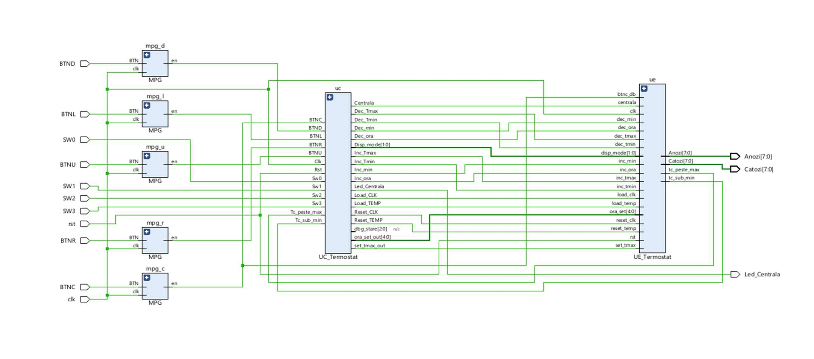
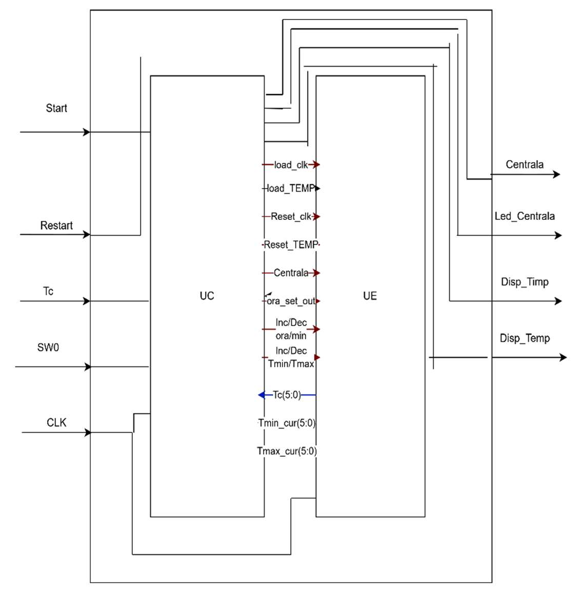
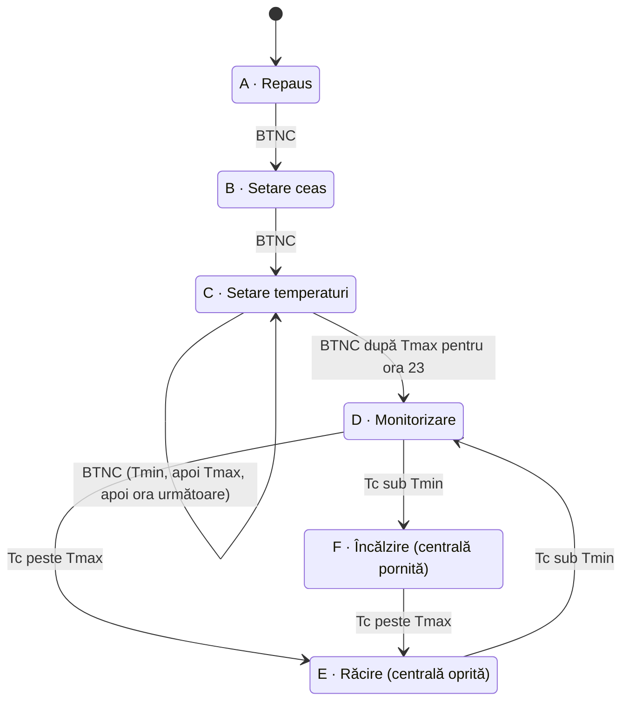

# Termostat pentru centrală termică pe FPGA (VHDL)

Termostat programabil pe 24 de ore pentru o centrală termică de apartament, implementat în VHDL pe placa **Digilent Nexys A7-100T** (Xilinx Artix-7). Sistemul păstrează ora curentă, permite programarea unei temperaturi minime și a uneia maxime pentru fiecare oră din zi și comandă pornirea/oprirea centralei în funcție de temperatura din apartament.

Proiect realizat la disciplina *Proiectarea Sistemelor Numerice* (tema A14 – Termostat pentru centrală termică).
Autor: **Bucur Vlad-Andrei**



## Funcționalități

- **Ceas digital 24h** (HH:MM), setabil din butoane.
- **Program pe 24 de ore**: câte o pereche `Tmin` / `Tmax` pentru fiecare oră, stocată în două memorii RAM de 24 × 6 biți.
- **Comandă cu histerezis**: centrala pornește când temperatura scade sub `Tmin` și se oprește când trece de `Tmax`.
- **Model termic simulat**: cu centrala pornită temperatura crește cu 1 °C/s, iar cu centrala oprită scade cu 1 °C la 3 s (domeniu 0–50 °C).
- **Modificare în timp real** a pragurilor pentru ora curentă, fără reprogramarea întregii zile.
- **Afișaj pe 8 cifre cu 7 segmente** (ora, temperatura curentă și valorile programate) și un LED care arată starea centralei.

## Arhitectură

Designul este împărțit clasic în **Unitate de Control (UC)**, adică un automat Moore cu 6 stări, și **Unitate de Execuție (UE)**, care conține resursele: memorii, registre, contoare, comparatoare, divizoare de frecvență și driverul de afișaj.



### Automatul de stări (UC)



| Stare | Ieșiri active | Afișaj |
|---|---|---|
| **A** – Repaus | `Reset_CLK`, `Reset_TEMP` dacă SW0 = 1 | HH:MM |
| **B** – Setare ceas | `Load_CLK`, Inc/Dec oră (BTNR/BTNL), Inc/Dec minut (BTNU/BTND) | HH:MM |
| **C** – Setare temperaturi | `Load_TEMP`, Inc/Dec Tmin sau Tmax (BTNR/BTNL) | ora setată : temperatura |
| **D** – Monitorizare | `Centrala = 0` | HH:MM și Tc |
| **E** – Răcire | `Centrala = 0`; cu SW3 = 1 se poate modifica Tmin | HH:MM și Tc |
| **F** – Încălzire | `Centrala = 1`, LED aprins; cu SW3 = 1 se poate modifica Tmax | HH:MM și Tc |

### Module

| Fișier | Rol |
|---|---|
| [`top_level_Termostat.vhd`](src/top_level_Termostat.vhd) | Nivelul superior: debouncere pentru butoane, UC și UE |
| [`UC_Termostat.vhd`](src/UC_Termostat.vhd) | Unitatea de control (automat Moore, stările A–F) |
| [`UE_Termostat.vhd`](src/UE_Termostat.vhd) | Unitatea de execuție, care interconectează resursele de mai jos |
| [`ram_Tmin.vhd`](src/ram_Tmin.vhd), [`RAM_Tmax.vhd`](src/RAM_Tmax.vhd) | Memorii 24 × 6 biți cu Tmin/Tmax pe ore (implicit 18 °C / 22 °C) |
| [`registru_Tmin.vhd`](src/registru_Tmin.vhd), [`registru_Tmax.vhd`](src/registru_Tmax.vhd) | Registre de lucru pentru valorile în curs de setare |
| [`Ceas_ore_min.vhd`](src/Ceas_ore_min.vhd) | Ceasul HH:MM (numărare automată și setare manuală) |
| [`contor_ora.vhd`](src/contor_ora.vhd) | Ora curentă folosită ca adresă de citire pentru memorii |
| [`SimulareTC.vhd`](src/SimulareTC.vhd) | Modelul termic al apartamentului (înlocuiește termistorul) |
| [`Comparator_Tmin.vhd`](src/Comparator_Tmin.vhd), [`Comparator_Tmax.vhd`](src/Comparator_Tmax.vhd) | Generează `Tc_sub_min` și `Tc_peste_max` pentru UC |
| [`ClockDivider.vhd`](src/ClockDivider.vhd), [`clock_divider_gen.vhd`](src/clock_divider_gen.vhd) | Divizor generic: tacturi de 1 min, 1 s și 3 s din 100 MHz |
| [`MPG.vhd`](src/MPG.vhd) | Debouncer care generează un singur impuls la fiecare apăsare |
| [`Display_Mux.vhd`](src/Display_Mux.vhd), [`Binar_la_BCD.vhd`](src/Binar_la_BCD.vhd) | Selectează ce se afișează și face conversia binar → BCD |
| [`ssd_driver.vhd`](src/ssd_driver.vhd), [`ssd_7seg.vhd`](src/ssd_7seg.vhd) | Multiplexarea afișajului pe 8 cifre și decodorul de 7 segmente |

## Interfața fizică (Nexys A7-100T)

| Element | Funcție |
|---|---|
| **SW15** | Reset general |
| **SW0** | Resetează ceasul și memoriile Tmin/Tmax (doar în starea A) |
| **SW3** | Permite modificarea Tmin/Tmax în timp real (stările E și F) |
| **BTNC** | Confirmare / Start |
| **BTNR / BTNL** | Incrementează / decrementează ora, Tmin sau Tmax |
| **BTNU / BTND** | Incrementează / decrementează minutele |
| **LED0** | Aprins când centrala funcționează |
| **Afișaj 7 segmente** | HH:MM, ora setată : temperatura, sau HH:MM și Tc |

Pinii sunt definiți în [`constraints/Nexys-A7-100T.xdc`](constraints/Nexys-A7-100T.xdc).

## Utilizare pe placă

1. **Reset**: SW15 sus, apoi jos. Sistemul pornește în starea A.
2. **Setarea ceasului**: apeși BTNC, apoi BTNR/BTNL pentru oră și BTNU/BTND pentru minute. Confirmi cu BTNC.
3. **Programarea temperaturilor**: pentru fiecare oră 0…23 setezi întâi Tmin (BTNR/BTNL, confirmi cu BTNC), apoi Tmax (confirmi cu BTNC). După ora 23, sistemul trece automat în monitorizare.
4. **Monitorizare**: afișajul arată ora și temperatura curentă. LED0 se aprinde cât timp centrala încălzește.
5. **Modificare din mers**: cu SW3 sus, în starea E sau F, BTNR/BTNL modifică pragul pentru ora curentă, iar BTNC îl salvează.

## Structura repository-ului

```
├── src/                  # Sursele VHDL ale designului
├── sim/                  # Testbench-ul UC și configurația formelor de undă (Vivado)
├── constraints/          # Constrângeri XDC pentru Nexys A7-100T
├── vivado/
│   ├── create_project.tcl    # Recreează proiectul Vivado
│   └── build_bitstream.tcl   # Proiect + sinteză + implementare + bitstream
├── docs/
│   ├── Documentatie_Termostat.pdf
│   └── img/
└── Makefile              # Simulare cu GHDL
```

## Cum rulezi proiectul

### Vivado (testat cu 2025.2)

Clonează repository-ul, apoi, din rădăcina lui:

```bash
vivado -mode batch -source vivado/create_project.tcl
```

Se creează `build/termostat/termostat.xpr`, cu `top_level_Termostat` setat ca modul principal și testbench-ul `simulare_UC` în setul de simulare. Poți rula scriptul și din interfața grafică: *Tools → Run Tcl Script…*

Ca să generezi direct bitstream-ul:

```bash
vivado -mode batch -source vivado/build_bitstream.tcl
```

### Simulare cu GHDL (fără Vivado)

```bash
make            # compilează tot designul și rulează testbench-ul
gtkwave build/ghdl/simulare_UC.vcd
```

Testbench-ul [`sim/simulare_UC.vhd`](sim/simulare_UC.vhd) parcurge automatul prin toate stările: setarea ceasului, programarea celor 24 de ore, monitorizare, încălzire și răcire.

## Note de implementare

- **Ceas accelerat pentru demonstrație**: în [`ClockDivider.vhd`](src/ClockDivider.vhd), tactul „de 1 minut” are `PERIOD => 1000`, deci un minut din ceas trece într-o secundă reală. Pentru timp real se folosește `PERIOD => 60000`.
- **Temperatura este simulată** de modulul `SimulareTC`, nu citită de la un senzor real.
- `MPG` (debouncer) și `ssd_driver` (afișaj) sunt componente reutilizate din laboratoarele de PSN.

## Îmbunătățiri posibile

- Afișarea temperaturii cu o zecimală (de exemplu 20.5 °C).
- Mod de vacanță, cu o temperatură minimă de protecție împotriva înghețului.
- Alarmă sonoră pe ieșirea audio PWM a plăcii la schimbarea stării centralei.

Detalii complete despre proiectare (black box, resursele UE, organigramă, procedura de utilizare) găsești în [documentația PDF](docs/Documentatie_Termostat.pdf).
